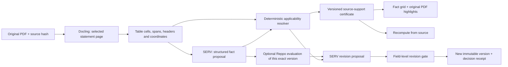
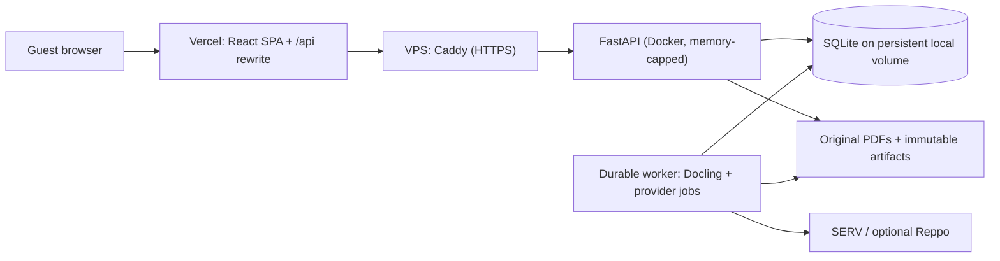

<p align="left"></p>

# Evi

**Evi is short for Evidence:** every financial figure should come with the source and context that support it.

**Keep the period, unit and source attached to every financial number.**

Evi helps financial analysts check whether an extracted figure means what they intend to use it for. It combines Docling table structure, SERV interpretation and a deterministic source-binding engine, then lets the reviewer inspect the original PDF cells behind the result.

[**Open Evi**](https://evi-lovat.vercel.app) · [**▶ Demo video**](https://youtu.be/K24nZH__pcI) · [Guided walkthrough](docs/JUDGE-WALKTHROUGH.md) · [Measured results](https://evi-lovat.vercel.app/benchmark) · [Technical implementation](docs/TECHNICAL-DEPTH-IMPLEMENTATION.md)

Built for **SERV Hackathon Edition 02**, using **SERV Reasoning** for extraction/revision and **Reppo** for external evaluation. Public access requires no account or reviewer API key.

[](https://youtu.be/K24nZH__pcI)

## Reviewer overview

**The technical contribution is an executable test of whether a citation actually supports a financial claim.** A real cell from the wrong year, interval, attribution row or unit scope must fail even when its text is quoted correctly. Evi derives that applicability from the parsed table and records enough information to recompute the decision.

| Project fact | Evidence |
| --- | --- |
| Specific user and failure | An analyst comparing telecom financial statements can copy the correct digits with an incorrect reporting interval, monetary scale or parent-attribution scope. [Concrete cases](#the-failure-the-number-is-right-the-meaning-is-wrong). |
| Original mechanism | Twelve source-support obligations, structural context resolution, policy-versioned certificates and a field-level revision gate. [Implementation](docs/TECHNICAL-DEPTH-IMPLEMENTATION.md), [binding engine](backend/evi/binding.py), [revision gate](backend/evi/revision.py). |
| Real integrations | Docling parsed real issuer PDFs; SERV extracted and revised real facts; Reppo returned 11 actual evaluations. [Recorded integration evidence](#evidence-you-can-inspect). |
| Demonstrated failure detection | Experiment a's checker detected 34 model-output errors, with six false alarms and zero misses in 96 target observations. Labels are provisional and the sample is small. [Corrected analysis](artifacts/technical-proof/exp-2026-11-16-a/analysis-v2/summary.json). |
| Measured correction | Post-hoc experiment b: 62/96 → 74/96, 12 paired improvements and zero regressions; the same result occurs with and without Reppo feedback. [Comparison and definitions](#what-we-measured). |
| Public execution | A judge-style uploaded PDF was processed end to end on the public site: **fresh** Docling parse of the selected page, one SERV extraction, 6/6 supported certificates, re-verification, original-page highlight and reload recovery. [Upload execution record](artifacts/judge-upload/public-upload.json). An earlier registered-report run (Docling parse reused, Railway host) is also recorded: [execution record](artifacts/judge-release/live-2/live-job.json). |
| Reproducibility | Offline, read-only replay checks 288 required certificates and 20 revision receipts per experiment under its frozen policy. [Reproduction commands](#reproduce-the-frozen-proof-without-provider-calls). |
| Operational controls | Durable jobs, session-owned uploads, bounded processing and transactional paid-call reservations. [Runtime](#runtime-and-paid-call-boundaries), [allowance tests](backend/tests/test_allowance.py), [upload tests](backend/tests/test_upload.py). |

**Evidence index:** [human-readable claim map](#capability-and-verification-checklist) · [machine-readable JSON](docs/EVIDENCE-INDEX.json). The index separates code, recorded real execution, controlled tests and unverified outcomes; its numbers come from the linked artifacts.

**Shortest review path:** inspect the [wrong-row case](#the-failure-the-number-is-right-the-meaning-is-wrong), open the [binding engine](backend/evi/binding.py), follow the [real hosted job](artifacts/judge-release/live-2/live-job.json), then read the [four-arm comparison](#what-we-measured). The source-only inspection path requires no paid processing.

### Relation to the published judging criteria

OpenServ lists **creativity, user readiness and revenue potential** as its [judging criteria](https://www.openserv.ai/hackathon-2). The evidence relevant to each is:

| Criterion | Evi's case | Current boundary |
| --- | --- | --- |
| Creativity | Treat evidence applicability as a deterministic relation to be checked, then bind revisions to field-level obligations. | No claim of inventing PDF parsing or proving uniqueness against every financial-data product. |
| User readiness | Public guest access, guided cases, original-PDF inspection, live registered-report extraction, judge PDF upload with live processing, exports and reload-safe jobs. | Paid quota is finite (daily and total caps). One processing job runs at a time. |
| Revenue potential | A possible B2B review/API product for analyst teams that need an auditable path from a reported figure to a comparison or downstream dataset. | Buyer demand, time saved, pricing and willingness to pay have not been measured; no customer or revenue claim is made. |

## Try the mechanism

| Action | What to look for | What actually runs |
| --- | --- | --- |
| [Catch a nine-month/annual mismatch](https://evi-lovat.vercel.app/data?company=verizon&source_case=verizon-period&expect_period=12&expect_unit=USD&check=1) | Full year fails; selecting 9 months passes. Selecting USD millions also fails against the source's base-USD unit. | A browser-side rule check over a published SEC snapshot; no AI call. |
| [Inspect a source-supported correction](https://evi-lovat.vercel.app/workspace?document=verizon-3q2025&run=run_3f60316ec62f4d0bb449&version=ver_3f60316ec62f_5&fact=run_3f60316ec62f4d0bb449%3Ar5%3Averizon-3q2025%3Arevenue%3A3M%3A2025) | Open Value / Metric / Period / Unit. Inspect the `$` → `USD` revision, its source support and its immutable parent. | Stored outputs of earlier real provider runs, with original timestamps. |
| Re-verify from source in the fact panel | The server recomputes the certificate against registered PDF bytes and the saved Docling artifact. | A new deterministic verification; no SERV or Reppo call and no fresh PDF parse. |
| [Process an existing report](https://evi-lovat.vercel.app/workspace?document=att-3q2025) | Click Process report, watch its stages and reload while it runs. The same job returns. | A new SERV extraction while the server allowance permits it. A matching Docling parse may be reused and is labelled accordingly. |
| [Upload a public PDF](https://evi-lovat.vercel.app/workspace?upload=1) | Select your income-statement page and confirm it before processing. See [how upload works](docs/JUDGE-UPLOAD.md). | Fresh Docling parse of your page, one SERV extraction and certificates, verified publicly on the current host. Parsing one page takes under a minute; processing waits if another job is running. |
| [Read the experiment](https://evi-lovat.vercel.app/benchmark) and [evaluation history](https://evi-lovat.vercel.app/feedback) | Compare all four arms and follow each evaluation to the version it actually judged. | Recorded real evaluations and artifact-derived analysis. A new evaluation is a separate, budgeted action. |

**Availability is explicit.** New processing is limited by worker readiness, concurrency and server-side daily/cumulative allowances. When a limit is reached, the UI explains it; original results and source inspection remain available. Start with **Try Evi** for the guided path.

## The failure: the number is right, the meaning is wrong

An analyst copies revenue from an income statement into a comparison. The digits match the PDF, but the figure covers nine months rather than twelve, is expressed in millions rather than base dollars, or belongs to the common-stock attribution row rather than the reporting parent. A transcription-only check can pass while the comparison is misleading. The analyst then has to trace and repair it manually.

Two inspectable examples:

- **Period:** Verizon's SEC snapshot reports revenue of **USD 103.006 billion for January–September 2026** and **USD 34.313 billion for July–September 2026** in the same filing. Neither observation is full-year revenue. The [source manifest](src/data-manifest.json) preserves the exact dates, accession and original array positions.
- **Attribution:** a real extraction selected AT&T's **USD 4,464 million attributable to common stock** instead of **USD 4,500 million attributable to AT&T**. Both are real table values. Evi's source-binding checker flagged the mismatch; the historical external evaluation accepted the candidate. See the [corrected proof report](docs/PROOF-REPORT.md#9-addendum--proof-integrity-repair-2026-11-16-later-the-same-day) and [payload audit](docs/REPPO-PAYLOAD-AUDIT.md).

Docling is the parser Evi builds on. The original work is the layer that determines **which context applies to a value**, checks a model's claim against it and constrains revisions. Evi complements structured extraction; it does not replace Docling or establish that an issuer's accounting is true.

### Why this layer exists

The strongest simple alternatives are manual review against the original statement, or a structured filing feed when it already supplies the precise metric and interval required. Those can be the right tools. Evi targets the remaining PDF-to-fact workflow: keep the model's reading attached to table context, make its acceptance decision inspectable, and require any correction to satisfy the same source rules.

The contribution is visible at four boundaries: **a citation must apply to the cell; an unknown must remain unknown; a revision must preserve supported fields; and a reported improvement must survive a matched baseline comparison.** The four-arm experiment tests the last boundary rather than assuming that another evaluator improves extraction.

## How a fact becomes inspectable



### 1. Bind evidence to its applicable context

An evidence ID existing in a PDF does not make it support for every number on that page. The resolver uses Docling's row/column spans and source language to derive relations such as `row_label_for`, `column_header_for`, `duration_heading_for` and `unit_applies_to`.

For each candidate, it checks twelve obligations:

| Obligations | Question answered |
| --- | --- |
| S1 / S2 | Are the source and parse identities correct, and is the value cell readable? |
| M1 / M2 | Does the row match the metric and the consolidation/attribution scope? |
| P1 / P2 / P3 | Which year, duration heading and exact dates govern this column? |
| U1 / U2 | Which currency and scale apply, including per-share exceptions? |
| N1 / N2 | Is the printed number interpreted and normalized using decimal arithmetic? |
| C1 | Is there conflicting applicable context? |

Column-specific unit notes take precedence over table notes and captions. Equally specific conflicting notes remain conflicts. Per-share sections and percentage columns cannot masquerade as monetary metric rows. Multiple incompatible supported readings remain ambiguous.

**Unknown dates remain unknown.** The AT&T schedules print interval labels without exact end dates. Evi shows **Supported · dates not printed** and leaves those dates empty. When a printed month-end date and duration support a calendar-derived start date, the UI marks that start as derived. A supported reading and complete interval context are separate outcomes.

Implementation: [binding.py](backend/evi/binding.py) · [checks.py](backend/evi/checks.py) · [applicability rules and supported layouts](docs/TECHNICAL-DEPTH-IMPLEMENTATION.md).

### 2. Issue a certificate that can be recomputed

Each certificate records the source SHA-256, parse identity, Docling artifact hash, physical page coverage, policy version, target, proposed claim, field verdicts, applicable evidence paths and candidate resolution. Monetary values use decimal strings.

Re-verification reconstructs the result under the **policy that issued it**. It does more than compare a stored content hash: altered amounts, dates, scales, links or evidence IDs can fail even if someone recomputes the edited object's hash. The original PDF bytes and saved Docling structure are the inputs; re-verification does not rerun Docling or the model.

This is a machine-checkable record of source-support rules. It is **not a digital signature, an independent accounting audit or a guarantee of extraction accuracy**.

Implementation: [certificate construction and verification](backend/evi/binding.py) · [certificate CLI](backend/evi/certify.py).

### 3. Restrict what a revision can change

SERV proposes field patches. The application decides whether to accept them. A proposal cannot change the source, document, metric or target identity, invent evidence, annualize an interim amount or perform an unrecorded FX conversion. A better pass count is insufficient: previously supported fields must remain supported and every target must remain represented.

Accepted changes create a child version and a decision receipt. Rejected proposals and unchanged outcomes remain inspectable. An evaluator's score never overrides the source rules.

Implementation: [revision gate](backend/evi/revision.py) · [immutable extraction/version storage](backend/evi/extraction.py).

## Where SERV and Reppo contribute

| Component | Responsibility | Boundary |
| --- | --- | --- |
| Docling | Recover table structure and provenance from the selected PDF pages. | Page-scoped parsing is not full-report coverage. |
| SERV Reasoning | Interpret evidence into schema-validated financial claims; propose revisions from diagnostics and, when supplied, external critique. Recorded runs use `gpt-5.4-mini`. | No authority to edit sources, approve its own corrections or decide the scoring labels. |
| Deterministic engine | Resolve applicable context, normalize with Decimal, check claims and gate revisions. | Supports documented layouts; unresolved evidence stays unresolved. |
| Reppo | Evaluate the exact submitted version and return an external opinion. | A 100/100 evaluation is not measured financial extraction accuracy. |

Removing SERV removes the implemented interpretation/revision path. Removing Reppo removes external critique, while extraction and source verification remain usable. The experiments below test whether that critique improves results beyond the same revision without it.

## What we measured

**Five issuer PDFs, two issuers, three metrics, 48 fixed targets and two trials: 96 target observations per arm.** Targets distinguish current/prior-year annual, quarterly and year-to-date columns. These observations are correlated, not 96 independent documents.

The reference answers are **builder-drafted, source-reviewed and provisional**. Independent human review is **0/48** at this checkpoint. AT&T was initially designated issuer-separated holdout, but its pages were inspected during rule design; it is not a genuinely unseen test set.

| Arm | Configuration | Experiment a: reference match | Experiment a: composite | Experiment b: reference match / composite |
| --- | --- | --- | --- | --- |
| A | Docling + initial SERV extraction | 62/96 | 56/96 | 62/96 |
| B | A + deterministic checker | 62/96 | 56/96 | 62/96 |
| C | B + SERV revision, no external feedback | 62/96 | 56/96 | 74/96 |
| D | B + real Reppo feedback + SERV revision | 62/96 | 56/96 | 74/96 |

**Metric definitions:** reference match compares all frozen fields, deriving start dates from the model's own stated end date and duration independently of the checker's verdict. Matching null dates count as faithful absence, not interval completeness. Composite additionally requires a supported certificate. Complete-interval recovery is reported separately; in a's baseline it is **42/48 targets with printed dates**, not 42/96.

The primary scorer requires canonical `USD`; a bare `$` fails that currency field. The saved sensitivity analysis accepting `$` as USD raises baseline reference match to **86/96** in both experiments. These are different scoring conventions, not additional corrected monetary values. See [analysis.py](backend/evi/analysis.py) and the linked summaries before interpreting a headline accuracy figure.

**The external-feedback result is null: D equals C in both experiments.** Evi does not claim an accuracy improvement caused by Reppo.

- **Experiment a** was frozen before execution. The corrected independent-of-checker analysis finds **34 model errors detected, six checker false alarms and zero missed model errors** in this sample. It separates reference agreement from certificate support and interval completeness.
- **Experiment b** was designed after examining a. Better source-derived diagnostics and a checker-rule correction produced **12 paired improvements and zero regressions** in C and D. All improvements came from one revision branch. This is **post-hoc development evidence**, not fresh-holdout validation or a population accuracy claim.
- The 10 experiment-a Reppo evaluations returned **100/100 accept**, including candidates containing errors. The [packet audit](docs/REPPO-PAYLOAD-AUDIT.md) found that the evaluator received only candidate-cited cells; the correct competing attribution row was absent. The fuller v2 packet has been checked offline. A new calibrated comparison has not run.

**Artifact sources:** [a: corrected analysis](artifacts/technical-proof/exp-2026-11-16-a/analysis-v2/summary.json) · [b: corrected analysis](artifacts/technical-proof/exp-2026-11-16-b/analysis-v2/summary.json) · [public experiment export](public/evidence/experiments.v1.json) · [integrity review](docs/PROOF-INTEGRITY-REVIEW.md). Historical scores remain preserved; use the correction addendum when reading earlier report sections.

### Evidence you can inspect

| Evidence | Recorded result | Artifact |
| --- | --- | --- |
| Public fresh extraction with reload recovery | AT&T 3Q 2025; same job restored; one processing POST in the successful check; new SERV output with 12 facts/certificates. The page-2 Docling parse was reused. | [Job and browser observations](artifacts/judge-release/live-2/live-job.json) |
| Public integration acceptance | 26/26 recorded checks; includes source inspection, deep links, exports and small-screen behavior. | [Acceptance report](docs/JUDGE-ACCEPTANCE-REPORT.md) |
| Frozen experiment replay | a: 288/288 required binding-v2 certificates; b: 288/288 required binding-v3 certificates; 20 receipts per experiment. | [Read-only replay](backend/evi/replay.py), [integrity report](docs/PROOF-INTEGRITY-REVIEW.md) |
| All-history certificate audit | 618 historical certificates verified under their recorded policies. This is separate from experiment coverage and not the count of today's live certificates. | [Proof report and corrections](docs/PROOF-REPORT.md) |
| Reppo integration | 11 recorded real evaluations: 10 in experiment a plus an earlier evaluation. Experiment b reused the same feedback. | [Evaluation history](https://evi-lovat.vercel.app/feedback), [packet audit](docs/REPPO-PAYLOAD-AUDIT.md) |

The public live-release smoke tests used **two SERV calls** while repairing reload recovery and **zero new Reppo evaluations**. These are separate from the historical experiment calls. This README update makes no provider calls; evidence above is linked to its recorded execution, not presented as a new test run.

## Capability and verification checklist

| Capability | Implemented / demonstrated | Inspectable source |
| --- | --- | --- |
| Guest dashboard and guided test path | Recorded public acceptance; Home-first top navigation, no login or reviewer credentials. | [Walkthrough](docs/JUDGE-WALKTHROUGH.md), [acceptance report](docs/JUDGE-ACCEPTANCE-REPORT.md). |
| Period + unit checks | Browser metadata challenge and backend PDF source-binding engine; these are distinct mechanisms. | [Data explorer](src/DataExplorer.tsx), [binding engine](backend/evi/binding.py). |
| Original PDF, source identity and cell highlights | Recorded real-source checks, including differently offset FY2024 page coordinates. | [PDF viewer](src/PdfViewer.tsx), [acceptance report](docs/JUDGE-ACCEPTANCE-REPORT.md). |
| Source-support certificates | Twelve obligations, evidence paths, recorded policy and server-side recomputation. | [Certificate implementation](backend/evi/binding.py), [real-artifact tests](backend/tests/test_integration_real.py). |
| Immutable versions and constrained corrections | Real revision outcomes; controlled tests cover invented IDs, foreign evidence, annualization and field regressions. | [Revision gate](backend/evi/revision.py), [revision tests](backend/tests/test_revision_gate.py). |
| SERV + Reppo integration | Real stored outputs and 11 external evaluations; no Reppo-caused uplift established. | [Measured comparison](#what-we-measured), [payload audit](docs/REPPO-PAYLOAD-AUDIT.md). |
| Benchmark and offline replay | Frozen targets, separate metrics, read-only policy-aware verification and public artifact export. | [Analysis](backend/evi/analysis.py), [replay tests](backend/tests/test_replay.py), [experiment export](public/evidence/experiments.v1.json). |
| Job recovery and spending enforcement | Recorded public reload recovery; local fault/race tests; finite daily and total provider budgets. | [Hosted job](artifacts/judge-release/live-2/live-job.json), [allowance tests](backend/tests/test_allowance.py). |
| Judge-owned PDF upload | Verified end to end on the public site (fresh Docling parse → SERV → 6/6 supported certificates); local fresh-parse evidence; earlier failed hosted attempts kept as records. | [Upload status](#uploaded-pdf-acceptance-status), [upload implementation](backend/evi/uploads.py). |
| Provenance exports and inspectable real data | Recorded export checks and 103,644 source observations, explicitly separate from processed facts. | [Source manifest](src/data-manifest.json), [export code](src/export.ts). |

### Uploaded-PDF acceptance status

The upload flow now exists in [code](backend/evi/uploads.py) and has [operating instructions](docs/JUDGE-UPLOAD.md). Its scope is one public English-language telecom PDF in USD, at most 10 MiB/250 physical pages, with one confirmed statement page per run. Upload itself makes no provider call. Source files and derivatives are session-owned, use private/no-store responses and have a configured 24-hour retention; the implementation skips active jobs during cleanup.

The saved [local integration](artifacts/judge-upload/local-integration.json) records a fresh Docling parse of physical page 1: one table, 166 evidence items, four quarter/YTD year columns and zero provider calls. It uses a copy of a known development source, not a new accuracy holdout.

The [public execution record](artifacts/judge-upload/public-upload.json) (2026-11-16, VPS backend) shows the complete path on https://evi-lovat.vercel.app: upload of a copy of the Verizon FY2024 annual report, confirmed physical page 54, a **fresh** Docling parse (106 evidence items, 1 table), one SERV extraction, six facts (FY2024 and FY2023 revenue, operating income and net income attributable, USD millions), **6/6 supported certificates**, server-side re-verification `true`, a visible highlight on the original page, the same job after a mid-run reload and 404 for a second session. It uses a known development source, so it demonstrates the working path, not accuracy on unseen reports.

Two earlier hosted attempts on Railway are kept as records: the [first](artifacts/judge-upload/public-upload-attempt1-docling-disk.json) ran out of volume space for the Docling models, the [second](artifacts/judge-upload/public-upload-attempt2-railway-oom.json) exceeded Railway's 1 GB memory limit. Both failed before SERV (no paid call). Memory measurements: [Docling memory results](docs/DOCLING-MEMORY-RESULTS.md).

## Corpus and coverage

| Registered report | Physical statement page parsed | Period groups |
| --- | --- | --- |
| Verizon FY2025 10-K | 52 | Current/prior annual |
| Verizon FY2024 10-K | 54 | Current/prior annual |
| Verizon 3Q 2025 financial statements | 1 | Current/prior quarter and year to date |
| AT&T 3Q 2025 schedules | 2 | Current/prior quarter and year to date |
| AT&T 2Q 2025 schedules | 2 | Current/prior quarter and year to date |

The [source registry](backend/evi/corpus.py) records issuer URLs and hashes. Each parse records its page range. The supported metrics are **consolidated revenue**, **operating income/profit**, and **net income attributable to the reporting parent before preferred dividends**.

The separate [Real data explorer](https://evi-lovat.vercel.app/data) contains **103,644 USD observations**, including **4,037 core-metric observations**, from six issuer snapshots retrieved on November 15, 2026. Repeated comparative disclosures are retained. These counts describe source records, **not unique economic facts, PDF extractions, discovered errors or benchmark accuracy**. See the [data manifest](src/data-manifest.json).

## Runtime and paid-call boundaries



The backend runs on a 2 GB VPS (Singapore) as one Docker container (API + worker, capped at 1.4 GB plus swap) behind Caddy, with the Docling models baked into the image ([`deploy/docker-compose.vps.yml`](deploy/docker-compose.vps.yml)). A fresh one-page Docling parse peaks at about 1.1–1.3 GB, which did not fit Railway's 1 GB limit; Railway remains available as a rollback target. API and worker use one local persistent volume. Jobs have leases and persisted stages; reloading the UI recovers the active job. Unknown provider submissions are recorded for reconciliation rather than automatically resubmitted. This is not an exactly-once guarantee from an external provider.

Anonymous sessions own compute jobs. New work is bounded by the execution switch, worker readiness, concurrency, per-session limits, daily limits and an owner-configured cumulative allowance. [Allowance reservations](backend/evi/allowance.py) are transactional before provider submission. An optional allowance end time can also refuse new paid work; inspect the configured policy rather than assuming a universal seven-day lifetime.

Provider keys stay on the server. Source/evidence content and external critiques are untrusted input. A busy or exhausted paid path does not disable inspection of existing public evidence. See [deployment status](docs/LIVE-DEPLOYMENT-STATUS.md) and [deployment/backup runbook](docs/DEPLOYMENT.md).

## Run locally

Use **Python 3.12**, **Node.js 22.12+** and npm. Reuse an existing environment when available. The worker dependencies include Docling and CPU PyTorch; initial model installation/download can take time.

From the repository root, on Windows PowerShell:

```powershell
python -m venv backend/.venv
backend/.venv/Scripts/python -m pip install --extra-index-url https://download.pytorch.org/whl/cpu -r backend/requirements.lock
npm ci
```

For read-only development, start these in separate terminals from the repository root:

```powershell
# Terminal 1: API. Explicitly prevents paid execution in this process.
$env:EVI_EXECUTION_ENABLED = "false"
Set-Location backend
./.venv/Scripts/python -m uvicorn evi.api:app --host 127.0.0.1 --port 8000
```

```powershell
# Terminal 2: frontend. Vite proxies /api to localhost:8000.
npm run dev
```

Open [localhost:5173](http://127.0.0.1:5173). Registered PDFs are inspectable; historical facts require an existing/restored state. Start `python -m evi.worker` from the backend environment when testing worker behavior. Paid processing additionally requires server-only credentials, an explicit allowance and execution enabled in the relevant API/worker processes; a key alone does not authorize a run. See [allowance code/configuration](backend/evi/allowance.py). Never put SERV or Reppo keys in `VITE_` variables.

### Reproduce the frozen proof without provider calls

Use the supplied release snapshot in an isolated state directory. Restore refuses a non-empty destination; choose a new directory on repeat runs. Source PDFs must be present under `public/sources` with their registered hashes. The commands below operate on a copy, not the active local database:

```powershell
Set-Location backend
$env:EVI_EXECUTION_ENABLED = "false"
$env:EVI_DATA_DIR = [IO.Path]::GetFullPath("../data/runs/readme-replay")
$env:EVI_SOURCES_DIR = [IO.Path]::GetFullPath("../public/sources")
./.venv/Scripts/python -m evi.backup restore ../data/release-snapshot $env:EVI_DATA_DIR
./.venv/Scripts/python -m evi.replay exp-2026-11-16-a
./.venv/Scripts/python -m evi.replay exp-2026-11-16-b
```

Replay opens the restored database read-only, derives required coverage from each manifest, checks certificate policies/receipts and recomputes saved scores in memory. Missing certificates, missing branches, wrong policies or edited scores fail. It does not overwrite the summaries it is comparing.

For automated verification from the repository root:

```powershell
backend/.venv/Scripts/python -m pytest -q backend/tests
npm test
npm run build
```

The [acceptance report](docs/JUDGE-ACCEPTANCE-REPORT.md) records test totals and distinguishes public checks, local tests, fakes and pending real calls. A test count alone does not establish provider integration or generalization.

## Current boundaries

- The measured proof covers five statement pages from two issuers, not arbitrary financial PDFs. Judge-owned upload is [verified end to end](#uploaded-pdf-acceptance-status) on a known development report; accuracy on unseen uploaded layouts is not measured. One job runs at a time on a small VPS, so a second judge may wait.
- Multi-page table continuations, 52/53-week calendars and unsupported row layouts can remain unresolved. A missing unit/title outside the parsed range is not invented.
- Source support does not establish issuer accounting truth. Partial interval context remains visibly partial.
- No independently reviewed reference set or genuinely unseen measured holdout is available yet.
- No measured Reppo improvement over the equivalent no-feedback revision has been established. Full-context packet calibration is pending.
- The implementation does not propagate restatements through downstream calculations, annualize interim results, infer missing metrics or apply unrecorded FX conversions.

## Read the code and proof

| Area | Entry point |
| --- | --- |
| Parsing and stable evidence IDs | [parsing.py](backend/evi/parsing.py) |
| Applicability, resolution and certificates | [binding.py](backend/evi/binding.py) |
| Structured extraction and immutable versions | [extraction.py](backend/evi/extraction.py) |
| Field-level revision decisions | [revision.py](backend/evi/revision.py) |
| External evaluation packets and lifecycle | [evaluation.py](backend/evi/evaluation.py) |
| Durable job queue and execution | [jobs.py](backend/evi/jobs.py), [worker.py](backend/evi/worker.py) |
| Paid-call allowance enforcement | [allowance.py](backend/evi/allowance.py) |
| Non-circular analysis and read-only replay | [analysis.py](backend/evi/analysis.py), [replay.py](backend/evi/replay.py) |
| PDF coordinates and evidence highlights | [PdfViewer.tsx](src/PdfViewer.tsx) |
| Reference review and its remaining work | [reviewer instructions](docs/REVIEWER-INSTRUCTIONS.md) |
| Historical README before the judge-facing rewrite | [Archived README](docs/archive/README-2026-11-16-before-rewrite.md) |

## Acknowledgements

Evi uses [Docling](https://github.com/docling-project/docling), [SERV Reasoning](https://docs.openserv.ai/) and [Reppo](https://docs.reppo.ai/). Original issuer reports and SEC snapshots retain their provenance; they are third-party source material.

The documentation structure was informed by the current [ASSAY README](https://github.com/OoJae/assay): a direct test path, inspectable evidence and explicit boundaries around model use. Evi's mechanisms, measurements and prose are its own. [README research notes](docs/README-RESEARCH-NOTES.md) record the reference and its verification limits.
