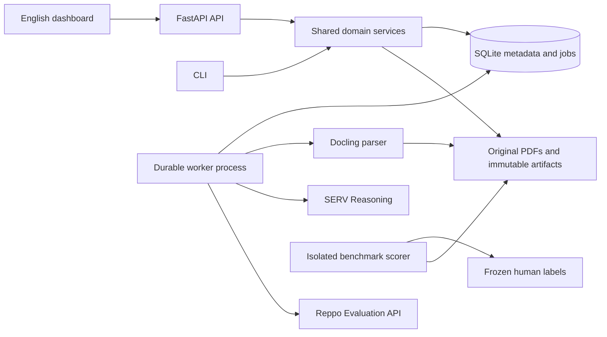

# 03 — System architecture

## First complete architecture



The scorer is not a callable agent tool. Gold labels are not accessible through normal extraction endpoints.

## Stack choices

- Python 3.12 for the core because Docling is a Python library.
- FastAPI and Pydantic for typed backend APIs.
- SQLite for local metadata, durable jobs, evaluation attempts, and version lineage. Enable foreign keys and use WAL where supported.
- Local filesystem for PDFs, Docling output, evidence packets, model responses, and exports. Write to temporary files and atomically rename completed artifacts.
- A separate Python worker claims jobs from SQLite and heartbeats its lease. No Redis/Celery requirement for the initial bounded single-user build.
- React + TypeScript + Vite is the proposed eventual dashboard stack. It is a client of the same API, not a second implementation of extraction logic.
- Use an HTTP client with explicit timeouts and validated provider responses.

## Domain components

| Component | Responsibility | Must not do |
| --- | --- | --- |
| Corpus registry | IDs, provenance, source hashes, splits, page coverage | Infer golden financial values |
| Docling adapter | Parse tables/text, preserve cell coordinates | Become a replacement OCR/table engine |
| Evidence builder | Bind cells to headers and unit/period context | Pull labels into model context |
| Semantic extractor | SERV structured candidate facts | Compute canonical money with floating point |
| Verification engine | Anchoring, parsing, units, intervals, compatibility | Treat model confidence as correctness |
| Reppo adapter | Submit, persist IDs, poll, normalize critiques | Invent a settled result |
| Revision coordinator | Bounded evidence-backed correction loop | Rewrite the baseline or scoring rules |
| Benchmark scorer | Compare predictions to frozen human labels | Guide the inference agent using gold errors |
| Exporter | Reproducible CSV/JSON/Markdown | Hide unresolved values or leaked secrets |

## Proposed repository layout

```text
evidencegrid/
  api/                 # routers, request contracts, local service entry point
  domain/              # facts, checks, numeric and period interpretation
  parsing/             # Docling adapter, evidence cells, context windows
  agents/              # SERV extraction/investigation/revision
  providers/           # SERV and Reppo transport adapters
  jobs/                # durable state machine and worker
  storage/             # DB repositories and artifact paths
  exports/             # CSV, JSON, Markdown serializers
  benchmark/           # isolated scoring; never exposed as an inference tool
  cli.py
web/                   # later dashboard implementation, English copy
config/
  corpus.json
  policies/
data/
  sources/             # original public PDFs; provenance recorded
  parsed/              # raw Docling output and evidence index
  runs/                # immutable initial/revised outputs and provider artifacts
  labels/              # frozen human labels, isolated from inference
  exports/
tests/
  unit/
  integration/
  fixtures/            # clearly labeled controlled cases and API contracts
scripts/
docs/                  # this handoff plus future operational documentation
```

Directories currently present may be empty. This tree describes the intended implementation, not existing code.

## Storage entities

Implement documents, parse jobs/results, evidence cells/windows, extraction runs, fact versions, check results, provider attempts, evaluations, revision proposals, benchmark runs, and exports. Store large payloads as immutable JSON files referenced by hash/path. Use database foreign keys to preserve version relationships.

## Job execution

- A job has a durable state, lease owner, lease expiration, attempt count, next eligible time, and result/error reference.
- Claim work transactionally so two workers cannot perform the same local operation concurrently.
- Heartbeat long Docling parses. Recover expired leases after worker interruption.
- A completed parse is reusable only for matching source hash, page range, parser version, and parser settings.
- A pending Reppo evaluation is resumed with its original `evalId` after a restart.
- Local idempotency does not imply external exactly-once submission. Reppo POST timeouts require an unknown-outcome state.

## Configuration and secrets

Document these environment variables in a future .env.example:

```text
SERV_API_KEY=
SERV_BASE_URL=https://inference-api.openserv.ai/v1
SERV_MODEL=gpt-6-luna
REPPO_API_KEY=
REPPO_BASE_URL=https://eval.reppo.xyz/api/v1
EVIDENCEGRID_DATA_DIR=./data
EVIDENCEGRID_DB_PATH=./data/evidencegrid.sqlite3
EVIDENCEGRID_MAX_REVISIONS=2
EVIDENCEGRID_MAX_REPPO_EVALUATIONS_PER_RUN=2
EVIDENCEGRID_REPPO_SETTLEMENT_MINUTES=10
```

The model ID above was in the inspected catalog; validate current availability before the first live run. Never echo key values. Expose only configured/unconfigured booleans to the browser.

## Trust and access boundaries

Initial mode is a local single-user app bound to localhost. Source selection comes from a curated manifest; do not add arbitrary remote URL fetching or public uploads as a convenience. This avoids a broad fetch service and keeps the benchmark reproducible. A later remote service needs explicit auth, safe URL handling, file limits, ownership checks, persistent storage, and worker deployment design.

PDF text and peer critiques are untrusted evidence. They must not cause shell execution, arbitrary tool calls, source edits, credential disclosure, or configuration changes. The agent's allowed tools only retrieve known evidence windows and propose typed fact edits.

## Parser deployment constraints

Docling can require model downloads, significant RAM, and CPU/GPU processing. Record actual runtime and installed versions. Do not deploy the parser inside a small edge-worker runtime or pretend a static hosted dashboard executes Python. The local app is the initial target; a later deployment may need separate API/worker hosting and persistent artifact storage.

## Observability

Record job IDs, document hashes, policy versions, provider request IDs, timings, usage fields, and explicit errors. Show application-level steps and evidence; do not claim access to a provider's private reasoning graph or hidden chain of thought. Never store secrets in logs.
